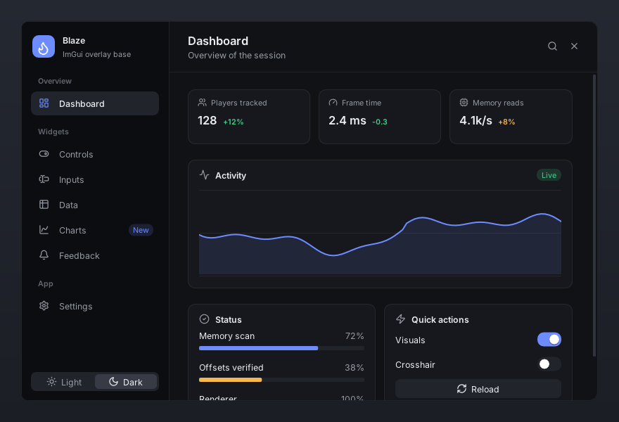
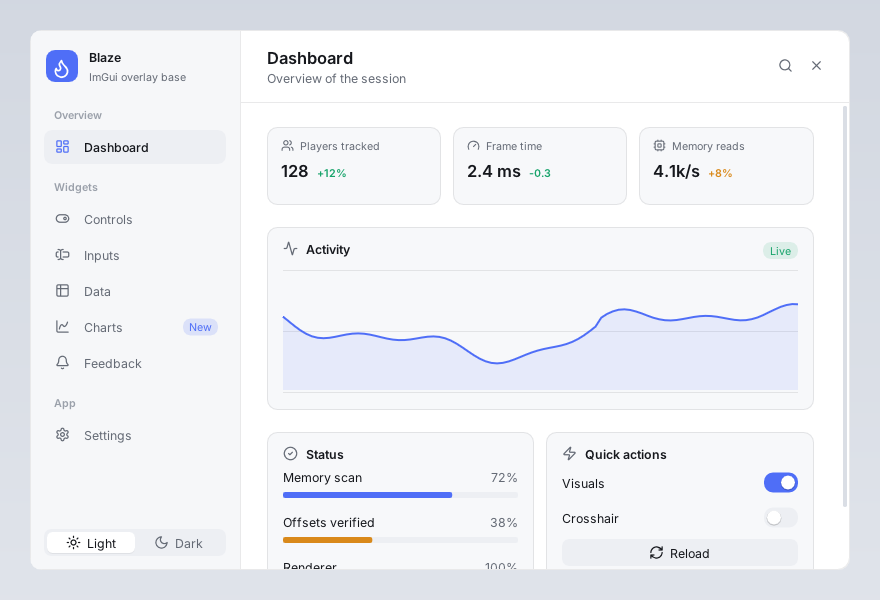
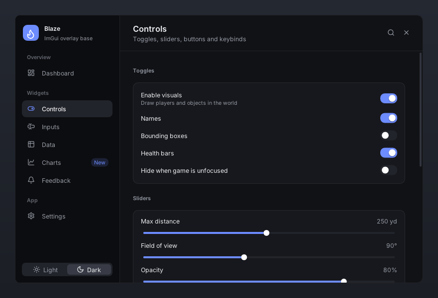
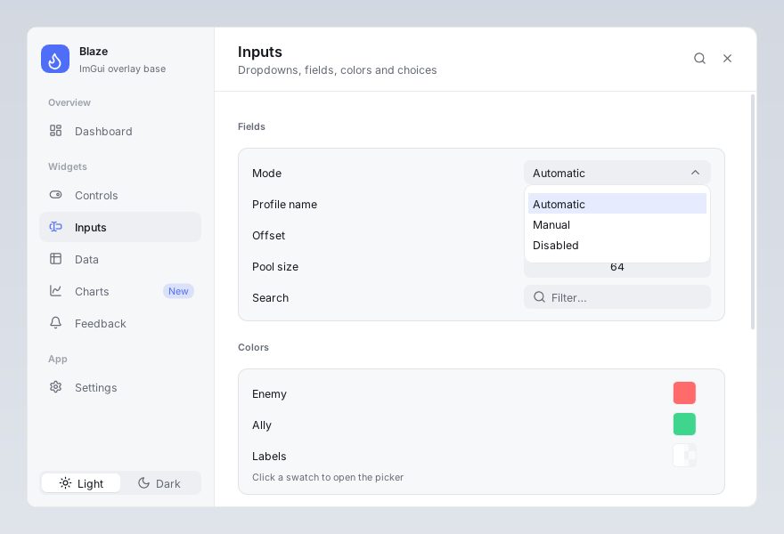
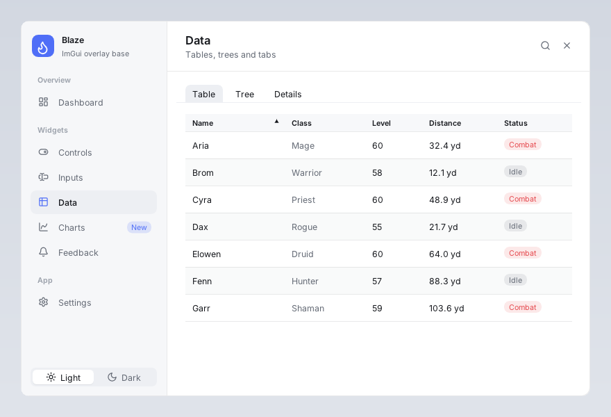
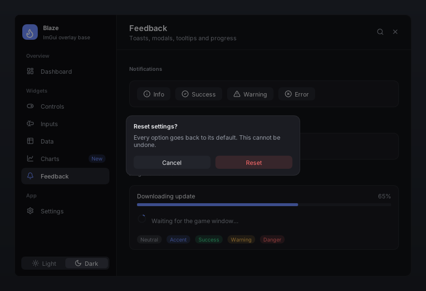
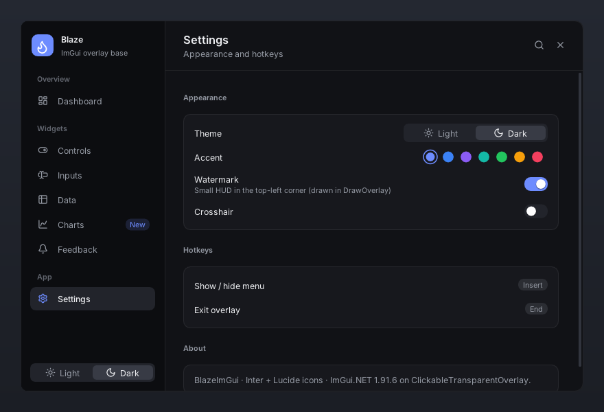

# BlazeImGui

A reusable, minimal and modern ImGui menu base for C# transparent overlays
(ImGui.NET 1.91.6.1 + ClickableTransparentOverlay 11.1.0, .NET 8, x64).



| | |
|---|---|
|  |  |
|  |  |
|  |  |

## Features

* **Drop-in base class** — derive from `BlazeOverlay`, add pages, `await Run()`. Fonts, theme, hotkeys
  (Insert / End), taskbar hiding, screen coverage or game-window following are handled for you.
* **Sidebar menu** with grouped pages, icons, badges, a gliding selection pill and page fade/slide transitions.
* **Light & dark themes** with a smooth cross-fade, plus a one-line accent color change.
* **Animated widgets** — toggles, checkboxes, sliders, buttons, segmented controls, keybinds, progress,
  spinner, fading tooltips, toasts, line chart, stat tiles, cards, sections and grids.
* **Every native ImGui widget is themed** — tables, plots, trees, tabs, combos, inputs, color pickers, modals.
* **Inter** typeface and **1,544 Lucide icons** merged into every font size, embedded in the DLL.
* No glows, gradients or neon — flat surfaces, hairline borders, generous spacing.

## Quick start

```xml
<ProjectReference Include="..\..\BlazeImGui\src\BlazeImGui\BlazeImGui.csproj" />
```

```csharp
using BlazeImGui;

sealed class MyOverlay : BlazeOverlay
{
    bool _enabled = true;
    float _distance = 250;

    public MyOverlay() : base(new OverlayOptions { Title = "My Tool", Subtitle = "v1.0" })
    {
        Menu.AddPage("General", Icons.House, () =>
        {
            Ui.BeginCard("main");
            Ui.Toggle("Enabled", ref _enabled);
            Ui.Slider("Distance", ref _distance, 10, 500, "0 'yd'");
            Ui.EndCard();
        });
    }
}

// Program.cs
using var overlay = new MyOverlay();
await overlay.Run();
```

**Full integration instructions (written for AI agents): [INTEGRATION.md](INTEGRATION.md).**

## Demo

```bash
dotnet run --project samples/BlazeImGui.Demo
```

Flags: `--theme light`, `--page "Charts"`, `--backdrop` (opaque background for screenshots), `--toast`.
Insert shows/hides the menu, End exits.

## Layout

```
src/BlazeImGui/
  BlazeOverlay.cs        base class (lifecycle, hotkeys, fade, follow window)
  OverlayOptions.cs      all settings
  Menu/Menu.cs           sidebar menu + pages
  Widgets/Ui.*.cs        themed, animated widgets
  Widgets/Notify.cs      toasts
  Theming/               Theme, Palette (dark/light tokens), Fonts
  Core/                  Anim, Input (keys), WindowTarget
  Icons.g.cs             generated Lucide constants
  Assets/Fonts/          Inter + Lucide (embedded)
samples/BlazeImGui.Demo  every widget on one overlay
tools/generate-icons.ps1 refresh the icon font + constants
```

## Licenses

Inter — SIL Open Font License 1.1 (`src/BlazeImGui/Assets/Fonts/Inter-LICENSE.txt`).
Lucide — ISC License (`src/BlazeImGui/Assets/Fonts/Lucide-LICENSE.txt`).
