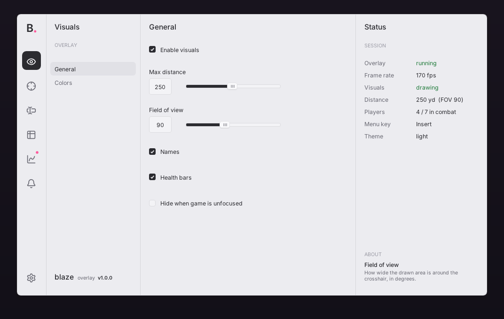
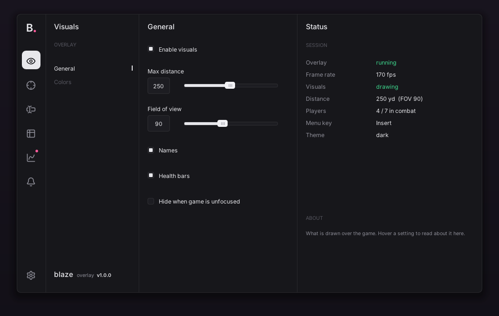
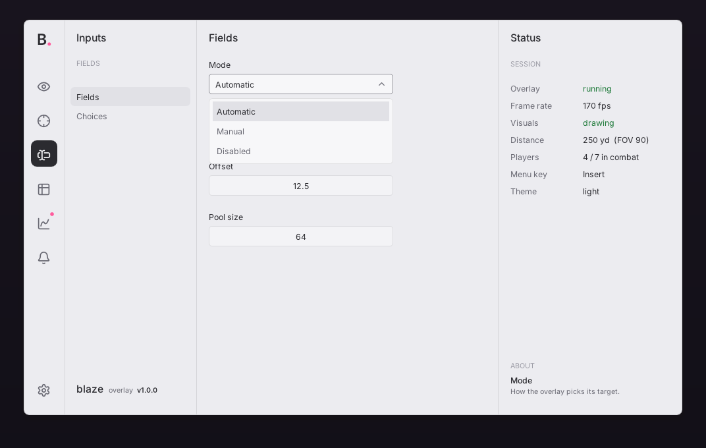
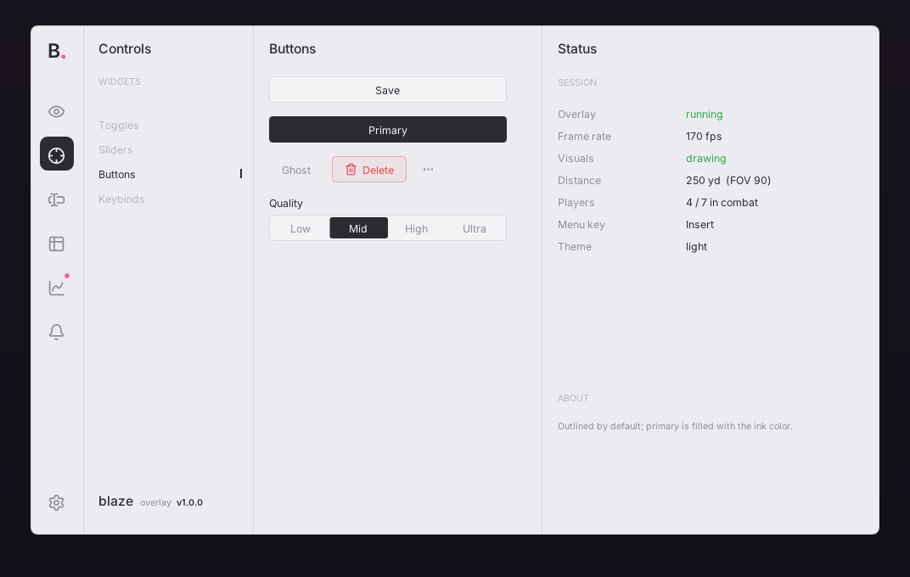
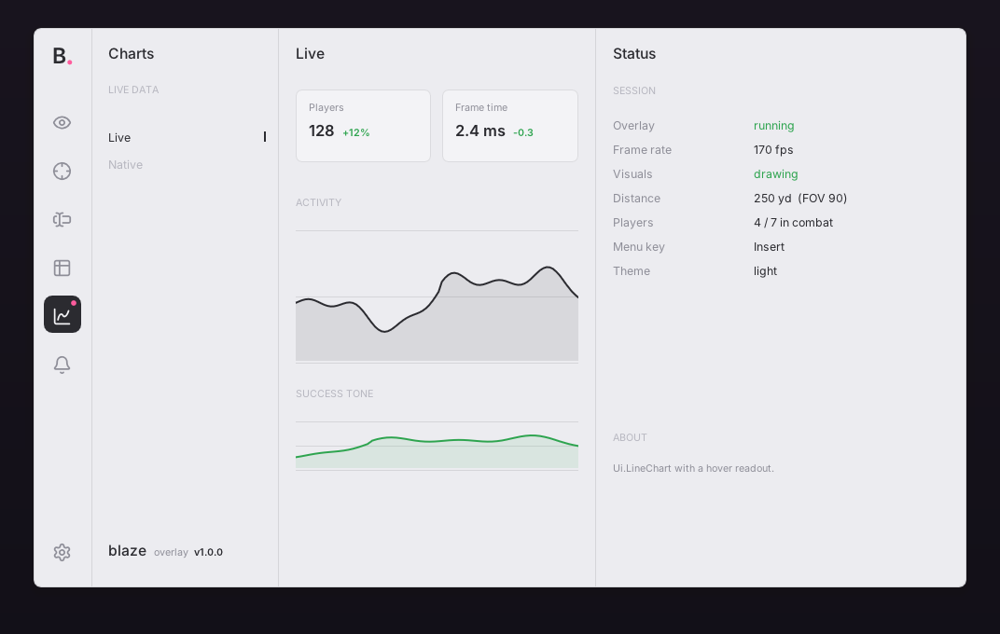
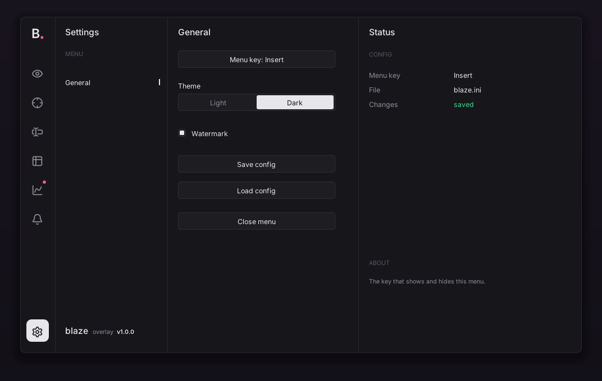

# BlazeImGui

A reusable, minimal and modern ImGui menu base for C# transparent overlays
(ImGui.NET 1.91.6.1 + ClickableTransparentOverlay 11.1.0, .NET 8, x64).



| | |
|---|---|
|  |  |
|  |  |
|  | |

## Features

* **Drop-in base class** — derive from `BlazeOverlay`, add pages, `await Run()`. Fonts, theme, hotkeys
  (Insert / End), taskbar hiding, screen coverage or game-window following are handled for you.
* **Four-column menu** — an icon rail with the brand mark, the page's tabs, the controls, and a status column
  with live readouts and an ABOUT hint that explains whichever control is hovered. The rail tile and tab
  marker glide; content fades in on every switch.
* **Light & dark themes** — soft grey surfaces, near-black ink for selection and fills, a single brand-colored
  dot; smooth cross-fade between themes.
* **Animated widgets** — checkbox rows, sliders with a value box and grip, outlined buttons and dropdowns,
  segmented controls, keybinds, readouts, progress, spinner, fading tooltips, toasts, line chart, stat tiles.
* **Every native ImGui widget is themed** — tables, plots, trees, tabs, combos, inputs, color pickers, modals.
* **Inter** typeface and **1,544 Lucide icons** merged into every font size, embedded in the DLL.
* No glows, gradients or neon — flat surfaces, hairline borders, generous spacing.

## Quick start

Pack the library into a `packages` folder in your repository, point a `nuget.config` at it, and reference
the package. Commit the `.nupkg` so your project builds from a plain clone on any machine
([INTEGRATION.md](INTEGRATION.md), section 2):

```powershell
tools\pack.ps1 -Into C:\code\MyTool\packages
```

```xml
<PackageReference Include="BlazeImGui" Version="1.0.0" />
```

```csharp
using BlazeImGui;

sealed class MyOverlay : BlazeOverlay
{
    bool _enabled = true;
    float _distance = 250;

    public MyOverlay() : base(new OverlayOptions { Title = "mytool", Version = "v1.0.0" })
    {
        var visuals = Menu.AddPage("Visuals", Icons.Eye, "Overlay");
        visuals.AddTab("General", () =>
        {
            Ui.Toggle("Enabled", ref _enabled, "Shown under ABOUT while hovered.");
            Ui.Slider("Distance", ref _distance, 10, 500, "0");
        });
        Menu.Status = () =>
        {
            Ui.Caption("Session");
            Ui.Readout("Overlay", "running", Tone.Success);
        };
    }
}

// Program.cs
using var overlay = new MyOverlay();
await overlay.Run();
```

**Full integration instructions (written for AI agents): [INTEGRATION.md](INTEGRATION.md).**

**C++ / native Dear ImGui (1.92+)?** The same menu as a C++ library: [cpp/README.md](cpp/README.md).

**Rust?** The same menu as a crate on `dear-imgui-rs`: [rust/README.md](rust/README.md).

## Demo

```bash
dotnet run --project samples/BlazeImGui.Demo
```

Flags: `--theme dark`, `--page "Charts"` or `--page "Controls/Sliders"`, `--backdrop` (opaque background for
screenshots), `--toast`.
Insert shows/hides the menu, End exits.

## Layout

```
src/BlazeImGui/
  BlazeOverlay.cs        base class (lifecycle, hotkeys, fade, follow window)
  OverlayOptions.cs      all settings
  Menu/Menu.cs           the menu window: rail, pages, tabs, status column
  Widgets/Ui.*.cs        themed, animated widgets
  Widgets/Notify.cs      toasts
  Theming/               Theme, Palette (dark/light tokens), Fonts
  Core/                  Anim, Input (keys), WindowTarget
  Icons.g.cs             generated Lucide constants
  Assets/Fonts/          Inter + Lucide (embedded)
  PACKAGE.md             README shipped inside the NuGet package
samples/BlazeImGui.Demo  every widget on one overlay
cpp/                     C++ port (Dear ImGui 1.92+)
rust/                    Rust port (dear-imgui-rs)
tools/pack.ps1           build the NuGet package (-Into copies it to a project feed)
tools/generate-icons.ps1 refresh the icon font + constants
tools/generate-cpp.ps1   regenerate the C++ icons + embedded fonts
tools/generate-rust.ps1  regenerate the Rust icons + copy the fonts
```

## Licenses

Inter — SIL Open Font License 1.1 (`src/BlazeImGui/Assets/Fonts/Inter-LICENSE.txt`).
Lucide — ISC License (`src/BlazeImGui/Assets/Fonts/Lucide-LICENSE.txt`).
