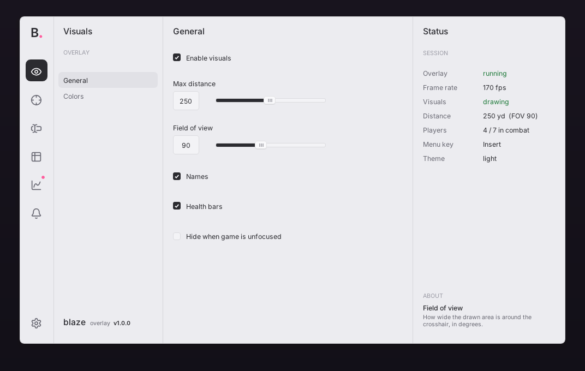

# BlazeImGui for Rust

The BlazeImGui menu (icon rail, tabs, status column with ABOUT hints, light/dark themes, animated widgets, toasts,
Inter + 1,544 Lucide icons) as a Rust crate on [`dear-imgui-rs`](https://crates.io/crates/dear-imgui-rs). It is a
port of the C# library in `src/BlazeImGui` with the same look, tokens and widget set (see the C++ port in `cpp/`
for native C++ hosts).



| Requirement | Value |
|---|---|
| Rust | 2021 edition, a recent stable toolchain |
| dear-imgui-rs | **0.21** (Dear ImGui 1.92+/1.93 WIP via cimgui, compiled from source by the `cc` crate) |
| C++ compiler | MSVC on Windows (any `cc`-supported compiler elsewhere) |
| Platform | Windows for `blaze_imgui::input` (GetAsyncKeyState); everything else is portable |

Any dear-imgui-rs host works: winit + glow/wgpu (`dear-imgui-winit`, `dear-imgui-glow`, `dear-imgui-wgpu`),
SDL3, Bevy, or the Win32/DX11 backend shims of `dear-imgui-sys` for hooks.

## Add it to a project

1. Copy `rust/blaze-imgui` into the target repository (e.g. `crates/blaze-imgui`), without `target/`. Never
   reference this folder from another repository.
2. Add it as a path dependency, and use the same `dear-imgui-rs` version in the app:

   ```toml
   [dependencies]
   blaze-imgui = { path = "crates/blaze-imgui" }
   ```

   `blaze_imgui::dear_imgui_rs` re-exports the binding, so the app can use it from there and stay in step.
3. Record where the copy came from (BlazeImGui commit, https://gitlab.com/Blvckberry/BlazeImGui) in a README next
   to it. Updates are made by copying a newer `rust/blaze-imgui` over it.

## Use it

Pages and tabs are closures over your application state: `Overlay<App>` lends `&mut App` to whichever closures run
this frame, so there are no `Rc<RefCell<…>>` captures.

```rust
use blaze_imgui::{icons, ui, Overlay, OverlayOptions, Tone};

struct App { enabled: bool, distance: f32 }

let mut overlay = Overlay::<App>::new(OverlayOptions {
    title: "mytool".into(),
    version: Some("v1.0.0".into()),
    ..Default::default()
});
overlay.menu.add_page("Visuals", icons::EYE, Some("Overlay")).add_tab(
    "General",
    |ui, app| {
        ui::toggle(ui, "Enabled", &mut app.enabled, Some("Shown under ABOUT while hovered."));
        ui::slider(ui, "Distance", &mut app.distance, 10.0, 500.0, |v| format!("{v:.0}"), None);
    },
    Some("What is drawn over the game."),
);
overlay.menu.set_status(|ui, app| {
    ui::caption(ui, "Session");
    ui::readout(ui, "Overlay", if app.enabled { "on" } else { "off" }, Tone::Success);
});

// once, after creating the dear-imgui-rs Context and before the renderer builds its font texture:
overlay.setup(&mut imgui);

// every frame, between `let ui = imgui.frame();` and rendering:
overlay.render(ui, &mut app);   // theme, the menu with its fade, toasts
```

The host routes input and handles its own hotkeys: `overlay.toggle_menu()`, `set_menu_visible()`; skip hotkeys while
`ui::is_capturing_key()` or `ui.io().want_text_input()`. Call `overlay.set_scale(s)` when the resolution changes
(games: `display_height / 1080.0`). A "Close menu" button calls `blaze_imgui::menu::request_close()`.

## Run the demo

```bash
cd rust/blaze-imgui
cargo run --example demo
```

Flags: `--theme dark`, `--page "Controls"` or `--page "Controls/Buttons"`, `--screenshot out.bmp` (renders
off-screen for a few frames, saves the back buffer, exits). Insert toggles the menu.

## Differences from the C# API

| C# | Rust |
|---|---|
| `class X : BlazeOverlay` | own an `Overlay<App>`, call `setup(&mut ctx)` / `render(ui, &mut app)` from your host |
| `Menu.AddPage(...)` / `page.AddTab(...)` | `overlay.menu.add_page(title, icon, caption)` → `&mut MenuPage` (`.add_tab`, `.set_status`, `.pin_bottom`, `.badge`, `.scroll`) |
| `Ui.Toggle("x", ref v, "desc")` | `ui::toggle(ui, "x", &mut v, Some("desc"))`: every widget takes the frame's `&Ui` first |
| .NET formats `"0 'yd'"` | a closure: `ui::slider(ui, "x", &mut v, 0.0, 1.0, \|v\| format!("{:.0}%", v * 100.0), None)`; `ui::slider_int` for integers |
| `ref int` indices | `&mut usize` for `combo` / `segmented` |
| `Icons.ChevronRight` | `icons::CHEVRON_RIGHT` (`&str`; `format!("{}  Save", icons::SAVE)`) |
| `Fonts.SemiBold` (ImFontPtr) | `fonts::semibold()` (`Font { font, size }`); `fonts::push/pop`, `.px()` for draw lists |
| `Theme.Colors.Text` | `theme::colors().text`; colors are `[f32; 4]`, `blaze_imgui::hex("#RRGGBB", 1.0)` |
| `Notify.Show(...)` | `notify::show(title, message, tone, seconds)` (thread-safe) |
| `Menu.CloseRequested` | `menu::request_close()`; the overlay hides the menu |

Rust/C++-only: `MenuPage::scroll = false` gives a page's tabs the whole body without scrolling; `Menu::center()` /
`window_center()`; the menu is never sized larger than the screen.

The library calls Dear ImGui through `dear_imgui_rs::sys` (cimgui), so it mirrors the C++ port line for line; the
public API is safe. dear-imgui-rs binds Dear ImGui 1.93 WIP, whose stroke alignment differs from 1.92, so hairlines
use `ImDrawFlags_StrokeLegacy` to stay one pixel wide.

## Files

```
blaze-imgui/
  src/lib.rs        re-exports
  src/menu.rs       the menu window (rail, tabs, content, status)
  src/ui.rs         widgets
  src/overlay.rs    setup / render / fade
  src/theme.rs      palettes, cross-fade, ImGui style
  src/palette.rs    color tokens
  src/fonts.rs      Inter + Lucide (include_bytes!)
  src/notify.rs     toasts
  src/anim.rs       easing keyed by ImGui IDs
  src/input.rs      GetAsyncKeyState keys, vk codes
  src/icons.rs      icons::* (generated)
  fonts/            Inter (SIL OFL 1.1) and Lucide (ISC), with licenses (copied by the generator)
  examples/demo.rs  winit + glutin + glow demo (--theme dark, --page, --screenshot file.bmp)
```

`tools/generate-rust.ps1` regenerates `src/icons.rs` and copies the fonts from `src/BlazeImGui` (after
`generate-icons.ps1`).
